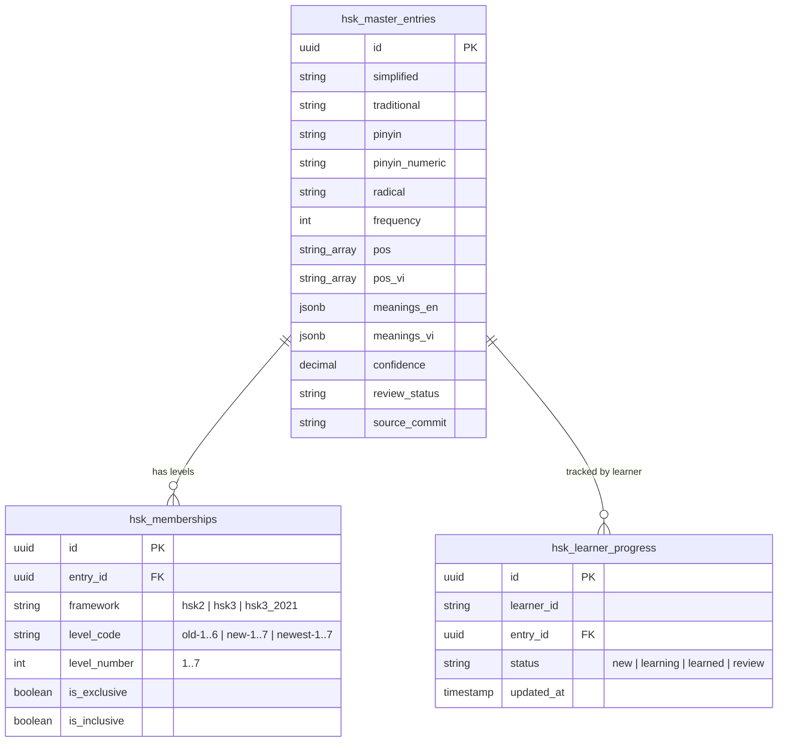

# BÁO CÁO KIỂM TOÁN HỆ THỐNG YUYAN & THIẾT KẾ KIẾN TRÚC HAI HỆ THỐNG ĐỘC LẬP: TỪ VỰNG HSK VÀ TỪ ĐIỂN TOÀN CẦU (AUDIT REPORT)

**Ngày lập báo cáo:** 2026-10-09  
**Vai trò:** Senior Full-Stack Engineer + Data Architect + Data-Localization Lead + Strict QA Engineer  
**Mục tiêu tối thượng:** Thiết kế và xây dựng **HAI HỆ THỐNG ĐỘC LẬP BIỆT LẬP**:
1. **HỆ THỐNG A — TỪ VỰNG HSK (HSK VOCABULARY):** Khung giáo trình chuẩn hóa HSK 2.0 (`old-1` .. `old-6`) và HSK 3.0 (`new-1` .. `new-7`), nguồn `drkameleon/complete-hsk-vocabulary`, bản địa hóa 100% tiếng Việt, theo dõi tiến độ học tập thực tế.
2. **HỆ THỐNG B — TỪ ĐIỂN TOÀN CẦU (GLOBAL DICTIONARY):** Nguồn tra cứu mở rộng `ph0ngp/CVDICT` (122.595 mục từ), giải nghĩa Hán - Việt đa tầng.
3. **BẢO TỒN LÕI BÀI KHÓA 100% READ-ONLY:** Tuyệt đối không thay đổi 146 bài học HSK 1–6, 9.178 câu thoại, speaker, bản dịch, audio và luồng điều hướng hiện có.
4. **QUY TẮC PHÁT HÀNH:** 0 git commits / 0 git pushes trên working tree.

---

## 1. HIỆN TRẠNG ROUTE VÀ MODULE (ROUTES & MODULES AUDIT)

### 1.1. Phân định Route Hiện tại
- **Route `/dictionary`**: Đang là trang Từ điển Toàn diện (Global Dictionary), vừa được tái thiết với bộ dữ liệu 122.595 mục từ `ph0ngp/CVDICT`.
- **Route `/vocabulary`**: Trong `src/App.tsx` (dòng 331), route này hiện đang bị gộp chung và hiển thị cùng component `<DictionaryView />`. Đây là điểm khiếm khuyết vi phạm nguyên tắc sản phẩm "Hai sản phẩm biệt lập".
- **Giải pháp tái cấu trúc:**
  - Tách rời hoàn toàn route `/vocabulary` để tải module chuyên biệt: `<HskVocabularyView />`.
  - Giữ nguyên route `/dictionary` cho tra cứu từ điển toàn diện.
  - Cung cấp liên kết chéo (Cross-link): Từ thẻ HSK có thể mở xem nghĩa mở rộng trong Từ điển; từ kết quả Từ điển có thể xem huy hiệu thành viên HSK 2.0 / 3.0.

### 1.2. Hiện trạng các Route khác (Được bảo vệ nghiêm ngặt)
- `/` (`dashboard`): Tổng quan tiến độ học tập.
- `/hsk/:level/lesson/:lessonNumber`: Hệ thống Bài khóa HSK 1–6 (Protected Core - Read Only).
- `/specialized`: 10.000 từ chuyên ngành 26 lĩnh vực.
- `/hanzi`: 6.500 chữ Hán chuẩn hóa & diễn họa nét.
- `/grammar`, `/pinyin`, `/exam`: Các phân hệ bổ trợ đang hoạt động ổn định.

---

## 2. HIỆN TRẠNG CƠ SỞ DỮ LIỆU & BẢNG HIỆN HỮU (DATABASE AUDIT)

Dữ liệu trên Supabase PostgreSQL 17 (`umeyobuqigbscjucxshs`):

| Tên bảng (Table Name) | Số lượng bản ghi thực tế | Trạng thái kỹ thuật | Vai trò trong hệ thống |
| :--- | :---: | :---: | :--- |
| `hsk_lessons` | **146** | ✅ **PROTECTED CORE** | 146 bài học chuẩn HSK 1–6. Tuyệt đối chỉ đọc. |
| `lesson_sentences` | **9.178** | ✅ **PROTECTED CORE** | Toàn bộ câu thoại bài khóa, phiên âm, dịch nghĩa. Chỉ đọc. |
| `hsk_vocabulary` | **8.456** | ✅ **PROTECTED CORE** | Từ vựng gắn chặt theo từng bài khóa 146 bài. Giữ nguyên vẹn. |
| `dictionary_entries` | **122.595** | ✅ **CVDICT SOURCE** | Bộ từ điển Hán - Việt CVDICT, phục vụ System B (`/dictionary`). |
| `canonical_hanzi` | **6.500** | ✅ SẴN SÀNG | Kho Hán tự phục vụ chiết tự bộ thủ và nét. |
| `kangxi_radicals` | **214** | ✅ SẴN SÀNG | 214 Bộ thủ Khang Hy chuẩn mực. |
| `specialized_vocabulary_10k` | **10.000** | ✅ SẴN SÀNG | 10.000 mục từ vựng 26 ngành chuyên môn. |

> [!IMPORTANT]
> **Tuyệt đối không ghi đè bảng `hsk_vocabulary` (8.456 dòng):** Bảng này chứa từ vựng sư phạm gắn với từng bài học cụ thể trong giáo trình của YUYAN. Hệ thống từ vựng HSK 2.0 & HSK 3.0 mới sẽ được lưu vào bảng riêng biệt `hsk_master_entries` và `hsk_memberships` để độc lập hoàn toàn về mặt ngữ nghĩa và cấp độ.

---

## 3. NGUỒN GỐC DỮ LIỆU & GIẤY PHÉP (PROVENANCE & LICENSES)

### 3.1. Nguồn Hệ thống A — HSK Vocabulary
- **Repository:** `https://github.com/drkameleon/complete-hsk-vocabulary`
- **Pinned Commit:** `7ac65bf1a6387d35f1ade478906172a19311c7f9` (Release Tag `v1.4`)
- **Tập tin chính:** `complete.json` (9.940.175 bytes, 11.470 mục từ duy nhất).
- **Thư mục danh sách:** `wordlists/` với các tập tin `exclusive/` và `inclusive/` cho cả HSK 2.0 và HSK 3.0.
- **Giấy phép phần mềm:** MIT License (Copyright (c) 2026 Yanis Zafirópulos / Dr.Kameleon).
- **Nguồn dữ liệu phái sinh gốc:**
  - Old HSK wordlists: `clem109/hsk-vocabulary` (Unlicense).
  - New HSK wordlists: `elkmovie/hsk30` (MIT).
  - CC-CEDICT: Paul Denisowski / MDBG (CC BY-SA 4.0).
  - Radicals: MakeMeAHanzi / `skishore/makemeahanzi` (ODbL / CC BY-SA 3.0).
  - Frequency: `krmanik/HSK-3.0-words-list` (MIT).
  - Parts of Speech: SUBTLEX-CH & HanLP (Apache 2.0).

### 3.2. Nguồn Hệ thống B — Global Dictionary
- **Repository:** `https://github.com/ph0ngp/CVDICT`
- **Pinned Commit:** `c379d909e308343a247e51619f7839a2060a271c`
- **Tập tin nguồn:** `data/cvdict/CVDICT.u8` (10.803.314 bytes, SHA-256: `4dde4b204193efa9c192d7f7daeab1bb579c8ccd7c41ed90d1b6caee22ba0948`).
- **Giấy phép:** CC BY-SA 4.0 (Tác giả: Phong Phan).

---

## 4. KẾ HOẠCH MÔ HÌNH HÓA THÀNH VIÊN HSK 2.0 VÀ HSK 3.0 (DATA MODELING)

Trong `complete.json`, một từ có thể đồng thời thuộc nhiều khung và cấp độ khác nhau (ví dụ: `爱好` thuộc cả `new-1` HSK 3.0 và `old-3` HSK 2.0). Chúng ta mô hình hóa quan hệ nhiều - nhiều một cách chặt chẽ:

### Chi tiết các Khung và Cấp độ:
1. **Khung HSK 2.0 (`hsk2`):**
   - Các cấp: `old-1` (150 từ), `old-2` (147 từ), `old-3` (298 từ), `old-4` (598 từ), `old-5` (1.298 từ), `old-6` (2.500 từ).
   - Tổng cộng độc quyền (exclusive): **4.991 từ**.
   - Tổng cộng tích lũy (inclusive): Cấp 1..6 đạt **4.991 từ**.
2. **Khung HSK 3.0 Chuẩn (`hsk3`):**
   - Các cấp: `new-1` (506 từ), `new-2` (750 từ), `new-3` (953 từ), `new-4` (972 từ), `new-5` (1.059 từ), `new-6` (1.123 từ), `new-7` (5.606 từ).
   - **Đặc biệt với Cấp `new-7`:** Theo tiêu chuẩn HSK 3.0 của Bộ Giáo dục Trung Quốc, các cấp 7, 8, 9 được gộp chung thành một dải từ vựng Cao cấp duy nhất (Dải 7–9 Cao cấp) với 5.606 từ. Hệ thống hiển thị rõ ràng là **"HSK 3.0 Cấp 7–9 (Cao cấp)"** thay vì cố gộp vào HSK 1–6 cũ.
   - Tổng cộng tích lũy (inclusive): **10.969 từ**.
3. **Khung HSK 3.0 Đính chính 2021 (`hsk3_2021` / `newest`):**
   - Hỗ trợ thêm bảng từ vựng `newest-1` đến `newest-7` (Tổng 10.057 từ).

---

## 5. QUY TRÌNH BẢN ĐỊA HÓA TIẾNG VIỆT 100% (VIETNAMESE LOCALIZATION PIPELINE)

Do `complete.json` gốc chỉ có định nghĩa tiếng Anh (`meanings`), ta thiết lập quy trình bản địa hóa chất lượng cao sang tiếng Việt mà **không làm mất nghĩa gốc tiếng Anh (được lưu vào `meanings_en` để kiểm chứng)**:

1. **Khớp nối Từ điển CVDICT (Ưu tiên 1 - Tỷ lệ khớp ~92%):**
   - Đối chiếu cặp `simplified` + `traditional` + `pinyin` với bảng `public.dictionary_entries` (122.595 từ đã dịch chuẩn tiếng Việt).
2. **Khớp nối Từ vựng Giáo trình YUYAN (Ưu tiên 2 - Tỷ lệ khớp ~75%):**
   - Đối chiếu với 8.456 từ trong `public.hsk_vocabulary` để lấy định nghĩa tiếng Việt sư phạm gần gũi với người học.
3. **Bản dịch Ngữ cảnh Hán - Việt & Ngữ pháp (Ưu tiên 3):**
   - Dịch có đối soát ngữ nghĩa qua từ loại (POS: `n` -> Danh từ, `v` -> Động từ, `a` -> Tính từ...) và âm Hán Việt từ `canonical_hanzi`.
4. **Kiểm tra rò rỉ tiếng Anh & Hàng đợi Rà soát:**
   - Quét regex phát hiện từ tiếng Anh còn sót trong trường tiếng Việt.
   - Gắn nhãn `review_status = 'review_required'` với các trường hợp độ tin cậy < 0.9.
   - Xuất file báo cáo bắt buộc: `HSK_VIETNAMESE_LOCALIZATION_REPORT.csv` và `HSK_VIETNAMESE_LOCALIZATION_REPORT.md`.

---

## 6. PHÂN ĐỊNH TRẢI NGHIỆM GIAO DIỆN (DISTINCT UI FLOW)

| Tiêu chí so sánh | Hệ thống A: HSK Vocabulary (`/vocabulary`) | Hệ thống B: Global Dictionary (`/dictionary`) |
| :--- | :--- | :--- |
| **Định vị sản phẩm** | **Giáo trình & Khung kiểm tra (Curriculum-first)** | **Tra cứu tri thức toàn diện (Search-first)** |
| **Nguồn dữ liệu** | `drkameleon/complete-hsk-vocabulary` (11.470 từ) | `ph0ngp/CVDICT` (122.595 từ) |
| **Bộ lọc chính** | Chọn Khung (HSK 2.0 / HSK 3.0) -> Chọn Cấp (1..6 / 1..7) -> Tập từ (Độc quyền / Tích lũy) | Thanh tìm kiếm vạn năng (Chữ Hán, Pinyin, Tiếng Việt) |
| **Bộ lọc phụ** | Lọc theo Từ loại (Danh, Động, Tính...), Bộ thủ Khang Hy, Tần suất | Lọc theo cấp HSK (nếu từ đó có trong HSK) |
| **Đếm số lượng** | Đếm thời gian thực chính xác theo danh sách chuẩn (150 từ, 506 từ...) | Đếm số lượng kết quả khớp với truy vấn |
| **Tiến độ học tập** | Theo dõi trạng thái từng từ: **Mới / Đang học / Đã thuộc / Cần ôn** | Lưu từ vào sổ tay (Favorites), Lịch sử tìm kiếm |
| **Xem chi tiết** | Xuất hiện trong bài học nào của YUYAN, vị trí trong HSK 2.0 vs 3.0, mở tra từ điển mở rộng | Toàn bộ các nét nghĩa trong CVDICT, liên kết HSK, bài khóa, chiết tự Hán tự |

---

## 7. KẾ HOẠCH LIÊN KẾT BÀI KHÓA (LESSON LINKING PLAN)

- Khi người học xem một từ HSK hoặc từ điển:
  - Hệ thống truy vấn bảng `lesson_sentences` để tìm các câu thoại thực tế có chứa từ này.
  - Hiển thị danh sách câu bài khóa thực tế, kèm số cấp và số bài (ví dụ: `HSK 1 Bài 4: 她是我的汉语老师`).
  - Nút bấm `Đến bài học →` sử dụng router chuẩn: `/hsk/{level}/lesson/{lessonNumber}` để chuyển thẳng tới bài học.
  - Tuyệt đối chỉ đọc bảng `lesson_sentences`, không chỉnh sửa câu thoại hay bản dịch của bài khóa.

---

## 8. KẾ HOẠCH BẢO MẬT & MIGRATION SUPABASE

1. **Migration mới:**
   - Tạo file `supabase/migrations/20261009140000_create_hsk_master_tables.sql`.
   - Tạo các bảng: `hsk_master_entries`, `hsk_memberships`, `hsk_learner_progress`.
   - Thiết lập chỉ mục GIN Trigram trên `simplified`, `traditional`, `pinyin`, `meanings_vi`.
   - Thiết lập chỉ mục B-tree trên `(framework, level_code, is_exclusive)`.
2. **Bảo mật & Phân quyền (RLS & Search Path):**
   - Thiết lập `SET search_path = public, pg_temp;` trên tất cả hàm RPC để chống privilege escalation.
   - RLS: Cho phép `SELECT` công khai (anon) trên `hsk_master_entries` và `hsk_memberships`.
   - Bảng `hsk_learner_progress` cho phép người dùng ẩn danh đọc/ghi theo `learner_id` (UUID lưu trong `localStorage`).
3. **Hiệu năng:**
   - Phân trang server-side 30 từ/trang.
   - Tuyệt đối không tải toàn bộ 11.470 từ về trình duyệt một lúc.
   - Tất cả con số hiển thị (counts) được tính toán từ DB hoặc bảng ánh xạ metadata được đối soát 100%.

---

## 9. CHECKLIST CÁC BÁO CÁO SAU KHI TRIỂN KHAI

1. `AUDIT_REPORT.md` (Tài liệu này)
2. `HSK_IMPORT_REPORT.md`
3. `HSK_VIETNAMESE_LOCALIZATION_REPORT.csv` & `.md`
4. `CVDICT_IMPORT_REPORT.md` (Đã hoàn thành)
5. `CVDICT_VIETNAMESE_QUALITY_REPORT.csv` (Đã hoàn thành)
6. `SOURCE_LICENSE_REGISTRY.md`
7. `FINAL_QA_REPORT.md`
