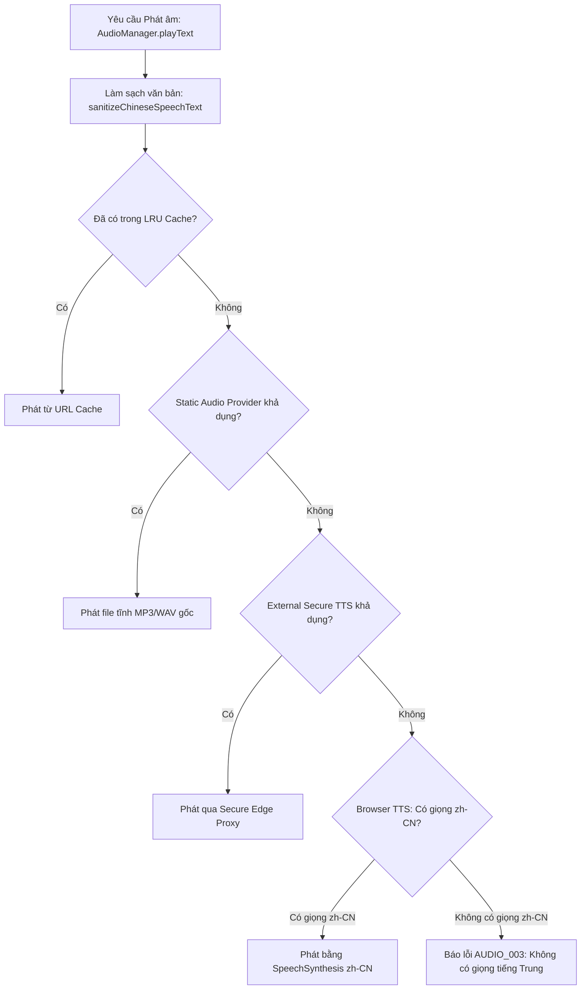

# YUYAN — Tài liệu Kiến trúc Hệ thống Âm thanh Chuẩn Tiếng Trung (Audio Subsystem)

> **Dự án:** YUYAN (语言)  
> **Tài liệu:** Thiết kế & Đặc tả Hệ thống Phát Âm Tiếng Trung Chuẩn Phổ Thông (`zh-CN`)  
> **Mã văn bản:** `DOC-AUD-003`  
> **Trạng thái:** Hoàn thiện (`PRODUCTION_READY`)

---

## 1. Nguyên tắc Bất khả Xâm phạm (Non-Negotiable Rules)

Hệ thống âm thanh của YUYAN phục vụ người học ngôn ngữ, do đó chất lượng và tính chính xác của âm thanh là tiêu chí sống còn:

1. **Tuyệt đối không phát âm sai ngôn ngữ:** Chỉ chấp nhận giọng đọc tiếng Trung phổ thông (`zh-CN`, `zh-Hans-CN`, `cmn-Hans-CN`).
2. **Nghiêm cấm Fallback sai lệch:** Nếu thiết bị của người dùng không có giọng đọc tiếng Trung, hệ thống **bắt buộc phải dừng lại và thông báo lỗi rõ ràng**: *"Thiết bị hiện không có giọng đọc tiếng Trung phù hợp."* Tuyệt đối không cho phép trình duyệt tự động dùng giọng đọc tiếng Anh (`en-US`) hoặc tiếng Việt (`vi-VN`) để đọc chữ Hán.
3. **Lọc văn bản trước khi phát (Sanitization):** Loại bỏ toàn bộ dấu câu tiếng Việt, ký hiệu đặc biệt, giữ lại nguyên vẹn chữ Hán, số và dấu câu tiếng Trung để âm đọc tự nhiên và liền mạch.
4. **Không rò rỉ bộ nhớ (Memory Leak Protection):** Mọi Object URL và Audio element được tạo ra đều được giải phóng (`URL.revokeObjectURL`) khi kết thúc hoặc chuyển bài.

---

## 2. Kiến trúc Thác nước Nhà cung cấp Âm thanh (Audio Waterfall Architecture)

`AudioManager` điều phối phát âm thông qua chuỗi ưu tiên (Waterfall Priority):



---

## 3. Quy trình Lọc Giọng Đọc Nghiêm ngặt (Strict zh-CN Voice Filtering)

Mã nguồn trong `src/services/audio/providers/browserTTSProvider.ts` kiểm tra danh sách giọng đọc của hệ điều hành với các tiêu chuẩn:

```typescript
// Các tiêu chí nhận diện giọng đọc tiếng Trung chuẩn xác:
const isChineseVoice = (v: SpeechSynthesisVoice) => {
  const lang = (v.lang || '').toLowerCase().replace('_', '-');
  const name = (v.name || '').toLowerCase();
  return (
    lang === 'zh-cn' ||
    lang === 'zh-hans-cn' ||
    lang === 'zh-sg' ||
    lang === 'zh' ||
    lang.startsWith('zh-') ||
    name.includes('mandarin') ||
    name.includes('chinese') ||
    name.includes('普通话') ||
    name.includes('huihui') ||
    name.includes('yaoyao') ||
    name.includes('kangkang') ||
    name.includes('xiaoxiao') ||
    name.includes('tingting')
  );
};
```

Ưu tiên hàng đầu: Giọng đọc phổ thông Bắc Kinh chuẩn (`zh-CN`, `zh-Hans-CN`, Microsoft Xiaoxiao, Microsoft Yaoyao, Google 普通话).

---

## 4. Hệ thống Quản lý Hàng đợi & Trạng thái (Queue & State Store)

- **`AudioState` (`src/services/audio/audioState.ts`):** Quản lý trạng thái phản ứng (Observable Pattern) với các trạng thái: `idle` | `loading` | `playing` | `paused` | `stopped` | `error` | `unsupported`.
- **`AudioQueue` (`src/services/audio/audioQueue.ts`):** Hỗ trợ phát liên tục danh sách các câu trong bài học (`playQueue`), tự động chuyển câu tiếp theo khi câu trước kết thúc, hỗ trợ `nextTrack()`, `prevTrack()`, `jumpToTrack(index)`.
- **`AudioCache` (`src/services/audio/audioCache.ts`):** Bounded LRU Cache (giới hạn 50 mục) với khóa hàm băm: `hash(text + lang + voice + rate + pitch)`.
