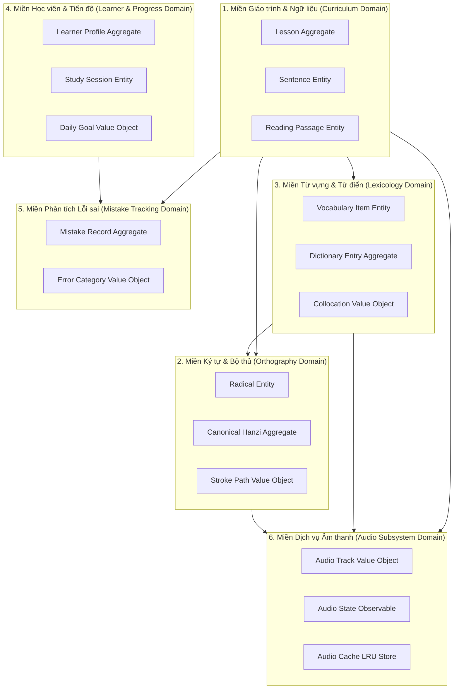

# YUYAN — Bản đồ Miền Dữ liệu (Database Domain Map / DDD Architecture)

> **Dự án:** YUYAN (语言)  
> **Tài liệu:** Thiết kế Kiến trúc Hướng miền (Domain-Driven Design - DDD Bounded Contexts)  
> **Mã văn bản:** `DOC-DOM-010`  
> **Trạng thái:** Hoàn thiện (`PRODUCTION_READY`)

---

## 1. Phân định Miền Giới hạn (Bounded Contexts)

Hệ thống YUYAN được phân tách thành 6 Bounded Contexts độc lập, đảm bảo nguyên lý trách nhiệm đơn lẻ (Single Responsibility Principle) và khả năng mở rộng lên cơ sở dữ liệu phân tán (PostgreSQL / SQLite / IndexedDB):

---

## 2. Chi tiết Từng Bounded Context

### 2.1. Curriculum Domain (Miền Giáo trình)
- **Aggregate Root:** `Lesson`
- **Thực thể con:** `Sentence`, `LessonSection`, `ReadingPassage`
- **Bất biến (Invariants):** Một bài học phải có ít nhất 1 câu bài khóa; thứ tự câu `index` là số nguyên tăng dần liên tục bắt đầu từ 1.

### 2.2. Orthography Domain (Miền Ký tự & Bộ thủ)
- **Aggregate Root:** `CanonicalHanzi`
- **Thực thể tham chiếu:** `CanonicalRadical`
- **Value Objects:** `StrokePath`, `CharacterDecomposition`
- **Bất biến:** Mọi chữ Hán phải thuộc về một bộ thủ Khang Hy hợp lệ từ 1 đến 214; số nét `strokeCount` phải bằng độ dài danh sách `strokeData`.

### 2.3. Lexicology Domain (Miền Từ vựng)
- **Aggregate Root:** `DictionaryEntry`
- **Thực thể con:** `EnrichedVocabularyItem`
- **Value Objects:** `PartOfSpeech`, `Collocation`
- **Bất biến:** Từ vựng phải có phiên âm Pinyin và nghĩa tiếng Việt không rỗng.

### 2.4. Learner & Progress Domain (Miền Học viên)
- **Aggregate Root:** `LearnerProfile`
- **Thực thể con:** `ProgressRecord`, `DailyStreak`
- **Bất biến:** Thời gian học tập `studyMinutes` và số từ đã thuộc không được là số âm.

### 2.5. Mistake Tracking Domain (Miền Lỗi sai)
- **Aggregate Root:** `LearnerMistake`
- **Bất biến:** Lỗi sai phải ghi nhận đáp án người dùng đã chọn và đáp án đúng thực tế của bài tập.
