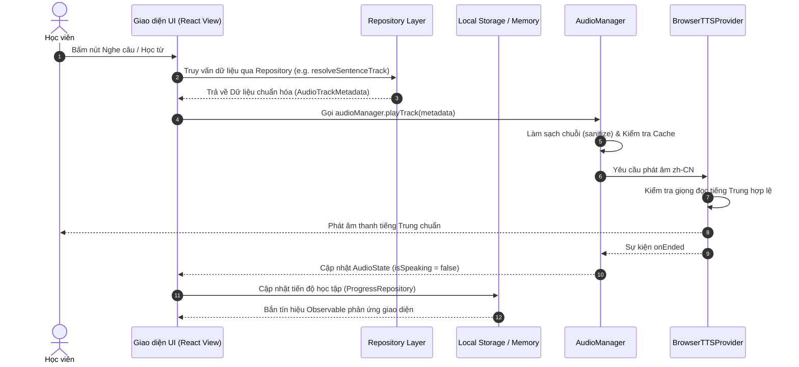
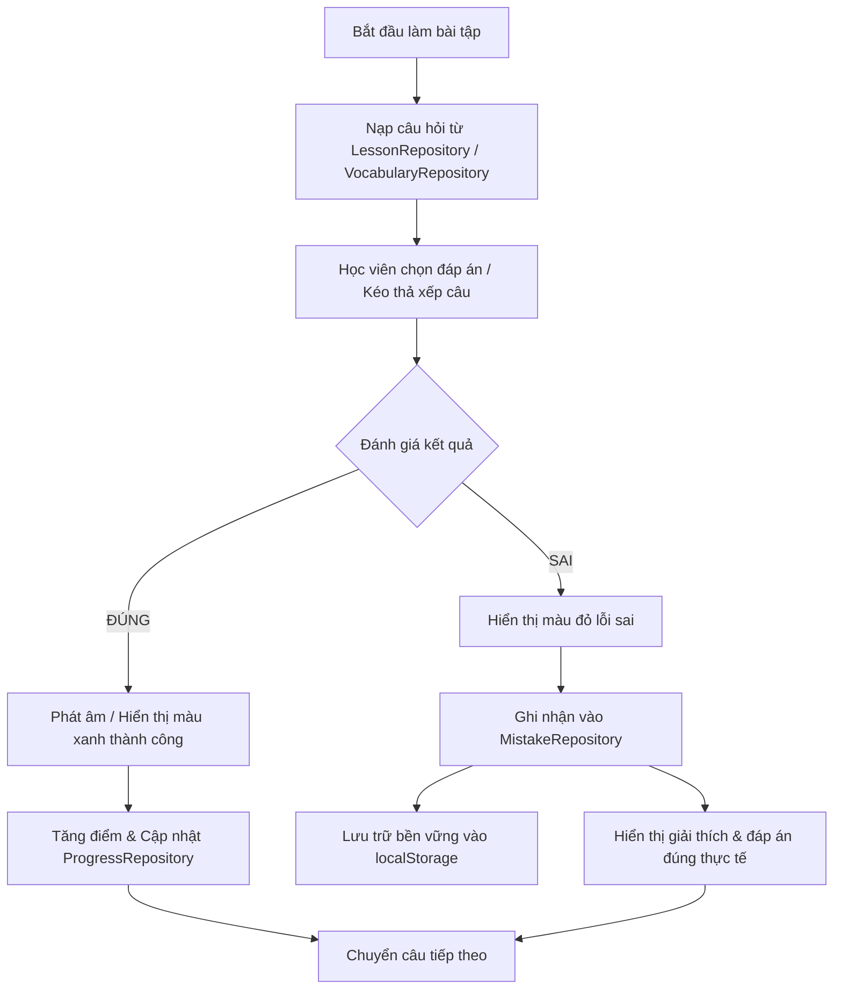

# YUYAN — Luồng Dữ liệu Một chiều & Vòng đời Sự kiện (Data Flow & Event Lifecycle)

> **Dự án:** YUYAN (语言)  
> **Tài liệu:** Thiết kế Luồng Dữ liệu Một Chiều & Vòng đời Xử lý  
> **Mã văn bản:** `DOC-FLW-011`  
> **Trạng thái:** Hoàn thiện (`PRODUCTION_READY`)

---

## 1. Kiến trúc Luồng Dữ liệu Một chiều (Unidirectional Data Flow)

YUYAN tuân thủ nghiêm ngặt mô hình luồng dữ liệu một chiều (Unidirectional Data Flow - UDF):

---

## 2. Vòng đời Xử lý Bài tập & Ghi nhận Lỗi sai (Exercise & Mistake Lifecycle)

Khi học viên làm bài tập trong các module `ListeningPracticeView` hoặc `SentenceOrderingView`:

---

## 3. Quản lý Khôi phục Trạng thái khi Khởi động Ứng dụng (App Boot & State Hydration)

Khi học viên mở ứng dụng:
1. `App.tsx` đọc `window.location.pathname` để xác định route hiện tại.
2. Nếu tại đường dẫn gốc `/`, đọc `localStorage.getItem('yuyan_study_state_v1')` để khôi phục bài học đang học dở dang.
3. Nếu dữ liệu lưu trữ bị hỏng hoặc chứa JSON không hợp lệ, hệ thống tự động bọc trong khối `try/catch`, xóa khóa lưu trữ hỏng và nạp bài HSK 1 Bài 1 một cách an toàn mà không làm sập ứng dụng.
4. `learnerRepository` nạp thông tin người học và đồng bộ thanh mục tiêu ngày.
