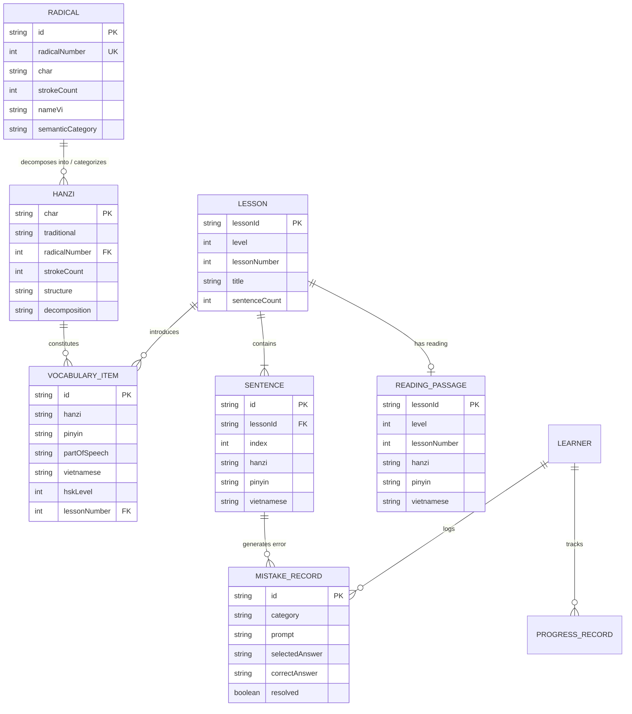

# YUYAN — Bản đồ Mối quan hệ Thực thể Dữ liệu (Data Relationship Map)

> **Dự án:** YUYAN (语言)  
> **Tài liệu:** Sơ đồ Cấu trúc & Mối quan hệ Thực thể Dữ liệu  
> **Mã văn bản:** `DOC-DAT-008`  
> **Trạng thái:** Hoàn thiện (`PRODUCTION_READY`)

---

## 1. Sơ đồ Thực thể - Mối quan hệ Cấp cao (High-Level Entity Relationship Diagram)

Hệ thống YUYAN liên kết chặt chẽ giữa 7 miền thực thể chính:

---

## 2. Quy tắc Ràng buộc Khóa Ngoại & Tính Toàn vẹn (Relational Integrity Rules)

| Mối quan hệ | Khóa chính / Khóa ngoại | Quy tắc ràng buộc | Xử lý khi tra cứu |
| :--- | :--- | :--- | :--- |
| **Radical ↔ Hanzi** | `Radical.radicalNumber` = `Hanzi.radicalNumber` | Mỗi ký tự Hán tự phải thuộc về ít nhất 1 trong 214 Bộ thủ Khang Hy | Nếu bộ thủ chưa nạp, tra cứu theo `radicalNumber` trả về fallback an toàn |
| **Hanzi ↔ Vocabulary** | `Hanzi.char` ∈ `VocabularyItem.hanzi` | Bóc tách từng ký tự Hán trong từ ghép để liên kết hai chiều | Cho phép xem mọi từ vựng HSK chứa chữ Hán đang học |
| **Lesson ↔ Sentence** | `Lesson.lessonId` = `Sentence.lessonId` | Khóa tổng hợp `hsk{level}_l{lessonNumber}_s{index}` bảo toàn thứ tự nghiêm ngặt | Không cho phép câu bị khuyết thiếu `hanzi`, `pinyin`, hoặc `vietnamese` |
| **Lesson ↔ Vocabulary** | `hsk{level}-bai{lessonNumber}` | Khóa bài học xác định chính xác từ mới của bài khóa tương ứng | Tự động đồng bộ vào bài học khi học viên mở tab "Từ mới" |
| **Lesson ↔ Reading** | `hsk{level}-bai{lessonNumber}` | Quan hệ 1:1 giữa bài học HSK và đoạn văn đọc hiểu bổ trợ | Tự động tách đoạn văn, câu hỏi đọc hiểu và từ xuất hiện lại |
| **Sentence ↔ Mistake** | `Sentence.id` → `MistakeRecord.entityId` | Khi người dùng trả lời sai ở bài tập Nghe hoặc Xếp câu, lưu vết thực thể | Cho phép làm lại bài tập câu sai và đánh dấu đã khắc phục |
