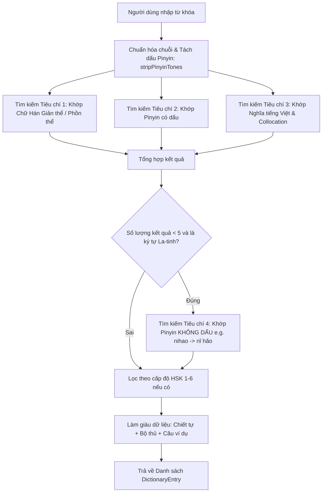

# YUYAN — Đặc tả Hệ thống Từ điển Tiếng Trung Tương hỗ (Dictionary Source & Engine)

> **Dự án:** YUYAN (语言)  
> **Tài liệu:** Thiết kế & Đặc tả Kiến trúc Bộ máy Tra cứu Từ điển  
> **Mã văn bản:** `DOC-DIC-005`  
> **Trạng thái:** Hoàn thiện (`PRODUCTION_READY`)

---

## 1. Mục tiêu & Nguyên lý Thiết kế

Từ điển trong YUYAN không phải là một danh sách từ đơn tĩnh, mà là **hạt nhân liên kết kiến thức** kết nối 4 thực thể cốt lõi:
1. **Từ vựng HSK (8,456 mục từ):** Cung cấp từ loại, nghĩa tiếng Việt, cách kết hợp tự nhiên (collocations), ngữ cảnh bài học.
2. **Chiết tự Chữ Hán (1,059 ký tự):** Tự động bóc tách từng chữ Hán cấu thành nên từ ghép (ví dụ từ "学习" được bóc tách thành "学" và "习").
3. **Bộ thủ Khang Hy (214 bộ thủ):** Truy nguyên bộ thủ gốc của từng chữ Hán trong từ (ví dụ "学" thuộc bộ Tử 子, "习" thuộc bộ Dực 羽).
4. **Câu ví dụ thực tế (9,178 câu):** Trích xuất tự động các câu bài khóa chứa từ vựng đó kèm phiên âm và dịch nghĩa chuẩn.

---

## 2. Thuật toán Tra cứu Đa tiêu chí (Multi-criteria Search Engine)

Hàm `DictionaryRepository.search(query, levelFilter)` trong `src/data/repositories/dictionaryRepository.ts` xử lý qua quy trình 4 giai đoạn:



---

## 3. Cấu trúc Thực thể Dữ liệu Tra cứu (`DictionaryEntry`)

```typescript
export interface DictionaryEntry {
  id: string; // Mã định danh duy nhất (e.g. vocab_1_1_你好)
  simplified: string; // Chữ Hán giản thể (e.g. 学习)
  traditional: string; // Chữ Hán phồn thể (e.g. 學習)
  pinyin: string; // Bính âm có dấu thanh (e.g. xuéxí)
  vietnamese: string; // Nghĩa tiếng Việt chuẩn xác (e.g. Học tập)
  hskLevel?: number; // Cấp độ HSK 1–6
  lessonNumber?: number; // Bài học xuất hiện lần đầu
  lessonTitle?: string; // Tên bài học tương ứng
  partOfSpeech?: string; // Từ loại: Động từ, Danh từ, Tính từ, v.v.
  collocations?: string; // Cụm từ kết hợp tự nhiên
  characters: Array<{ // Chiết tự cấu thành
    char: string;
    hanzi?: CanonicalHanzi;
    radical?: CanonicalRadical;
  }>;
  examples: Array<{ // Câu ví dụ trích xuất từ 9,178 câu bài khóa
    sentenceId: string;
    hanzi: string;
    pinyin: string;
    vietnamese: string;
    lessonTitle: string;
  }>;
  relatedWords: string[]; // Các từ ghép khác chứa cùng chữ Hán
}
```

---

## 4. Tương tác Người dùng & Điều hướng Liên thông

- **Phát âm từ:** Nút loa tích hợp gọi `audioManager.playText(word)` đảm bảo giọng đọc phổ thông `zh-CN`.
- **Xem chi tiết chiết tự:** Nhấp vào từng ô chữ Hán thành phần trong mục "Chiết tự" sẽ chuyển ngay sang màn hình `HanziView` hiển thị thứ tự nét viết và bảng vẽ 田字格.
- **Xem bài học gốc:** Nút liên kết ngoài chuyển thẳng đến đúng bài học trong 146 bài khóa HSK nơi từ vựng xuất hiện.
