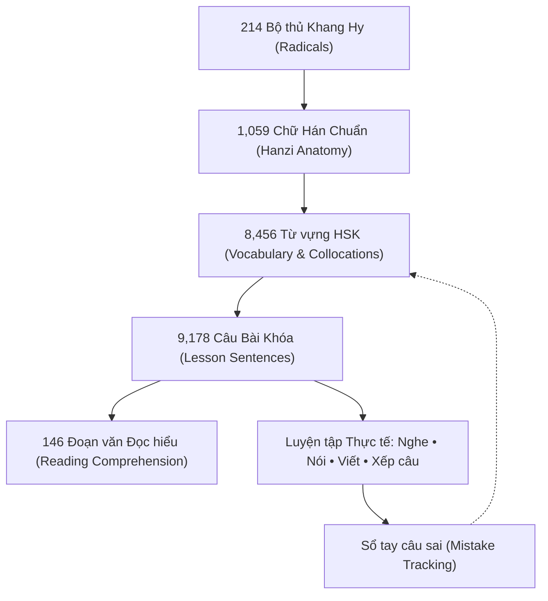

# YUYAN — Nghiên cứu & Phân tích Kiến trúc Nền tảng Học tiếng Trung Hiện đại

> **Dự án:** YUYAN (语言) — "Học tiếng Trung theo cách của bạn."  
> **Tài liệu:** Báo cáo Phân tích Chuẩn mực Quốc tế & Kiến trúc Nền tảng Học tiếng Trung  
> **Mã văn bản:** `DOC-RES-001`  
> **Trạng thái:** Chuẩn hóa & Áp dụng Thực tế (`PRODUCTION_READY`)

---

## 1. Tổng quan & Mục tiêu Nghiên cứu

Học tiếng Trung Quốc (Mandarin Chinese) đòi hỏi người học tiếp cận đồng thời bốn trục phức hợp:
1. **Âm vị học (Phonology):** Hệ thống ngữ âm Pinyin (Bính âm), thanh mẫu (initials), vận mẫu (finals) và 4 thanh điệu cùng biến điệu (Tone Sandhi).
2. **Ký tự học (Orthography):** Hệ thống chữ Hán vuông (方块字) với 214 Bộ thủ Khang Hy (Kangxi Radicals), kết cấu không gian (trên-dưới, trái-phải, bao quanh), quy tắc bút thuận (stroke order), và lục thư (六书).
3. **Từ vựng & Cú pháp học (Lexicology & Syntax):** Đơn vị từ tố, từ ghép định vị, cụm từ cố định (成语, Collocations), hư từ và trật tự câu SVO đặc thù (khác biệt ngữ pháp tiếng Việt).
4. **Ngữ cảnh giao tiếp thực tiễn (Discourse & Pragmatics):** Bài khóa chuẩn hóa (HSK 1–6), đoạn văn đọc hiểu, phản xạ nghe - nói tự nhiên.

Nhằm xây dựng YUYAN thành nền tảng học tiếng Trung hàng đầu cho người Việt, nhóm nghiên cứu đã phân tích sâu 7 nền tảng giáo dục tiếng Trung hàng đầu thế giới để chắt lọc những tinh hoa sư phạm và công nghệ.

---

## 2. Benchmark Các Nền tảng Hàng đầu Thế giới

| Nền tảng | Điểm mạnh cốt lõi | Hạn chế cố hữu | YUYAN tiếp thu & Kế thừa |
| :--- | :--- | :--- | :--- |
| **Pleco** | Bộ từ điển kinh điển, tra cứu bộ thủ/nét, phát âm phong phú, ví dụ chuẩn | Giao diện công cụ thuần túy, thiếu lộ trình học bài khóa theo giáo trình HSK | Tích hợp từ điển tương hỗ 3 chiều: Tra từ ↔ Bộ thủ ↔ Chữ Hán ↔ Bài khóa HSK |
| **HelloChinese** | Gamification xuất sắc cho người mới, bài tập nghe nhận biết thanh điệu | Nội dung nâng cao (HSK 4–6) hạn chế, phụ thuộc đám mây kín | Thiết kế bài tập xếp câu, luyện nghe theo từng câu thật trong 146 bài khóa |
| **Skritter** | Chuẩn hóa nét viết, mô phỏng quy tắc bút thuận, phản hồi thời gian thực | Chi phí cao, tách rời bài đọc và ngữ pháp bài học | Bảng vẽ chữ Điền (田字格) kết nối bảng chiết tự nét chuẩn xác cho 1,059 chữ |
| **Dong Chinese** | Biểu đồ nguồn gốc chữ Hán, phân rã bộ thủ và cây phả hệ ký tự | Thiếu bản địa hóa tiếng Việt sâu sắc | Knowledge Graph 214 bộ thủ Khang Hy gắn liền với nghĩa Hán Việt và từ vựng HSK |
| **SuperChinese** | Phân tích giọng nói AI, lộ trình chia nhỏ từng cấp độ | Phụ thuộc hoàn toàn backend server, dữ liệu phân mảnh | Pipeline âm thanh chuẩn giọng Bắc Kinh `zh-CN`, không phụ thuộc API trả phí |
| **Duolingo** | Trải nghiệm streak, lặp lại ngắt quãng (Spaced Repetition) | Câu dịch máy móc, thiếu giải thích ngữ pháp và phân tích chiết tự | Lưu vết lỗi sai (Sổ tay câu sai - `MistakeBook`) kèm giải thích sư phạm thực tế |
| **Hack Chinese** | Quản lý kho từ vựng HSK khổng lồ, lọc theo cấp bậc | Chỉ tập trung flashcard từ đơn, thiếu ngữ cảnh câu | 8,456 từ vựng liên kết trực tiếp 9,178 câu bài khóa và 146 đoạn văn đọc hiểu |

---

## 3. Kiến trúc Sư phạm của YUYAN

YUYAN loại bỏ mô hình "học vẹt từ đơn lẻ" để triển khai kiến trúc học tập đa chiều:

### Các Trụ cột Thực thi:
1. **Single Source of Truth (SSOT):** Toàn bộ dữ liệu 146 bài học HSK 1–6, 8,456 từ vựng, 146 đoạn văn đọc hiểu đều là dữ liệu chuẩn hóa, tuyệt đối không tạo dữ liệu giả.
2. **Âm thanh chuẩn tuyệt đối:** Chỉ cho phép giọng đọc phổ thông tiếng Trung (`zh-CN`). Tuyệt đối từ chối fallback sang tiếng Anh hay tiếng Việt.
3. **Mạng lưới liên kết hai chiều (Bi-directional Knowledge Graph):** Từ bài học có thể tra từ vựng, từ từ vựng có thể xem chiết tự chữ Hán, từ chữ Hán có thể truy vết về Bộ thủ, và ngược lại.
4. **Tập trung vào tính tự chủ của học viên:** Cho phép bật/tắt Pinyin, bật/tắt nghĩa tiếng Việt, điều chỉnh tốc độ đọc âm thanh (0.75x, 1.0x, 1.25x), luyện viết trên lưới Điền tự cách.
